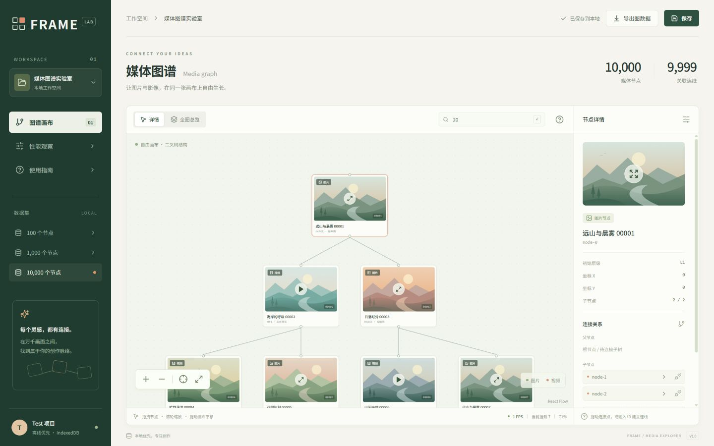
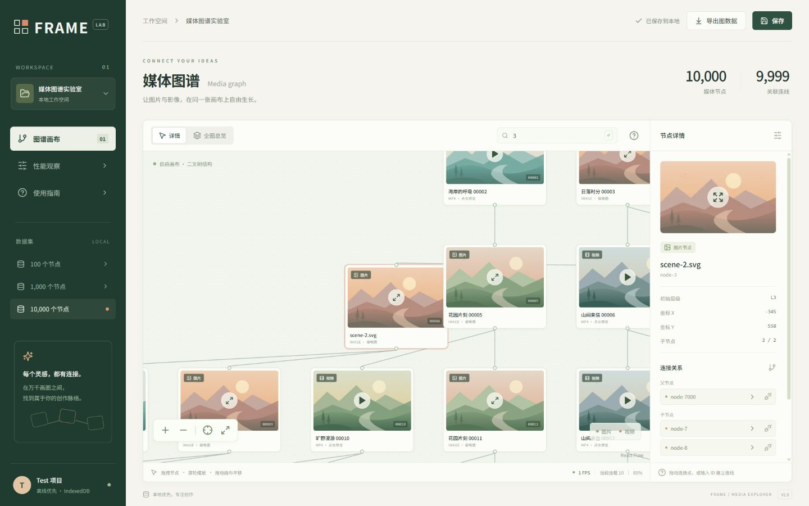
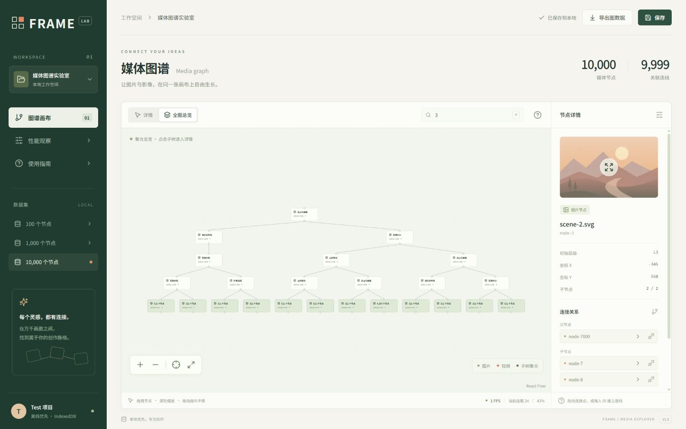
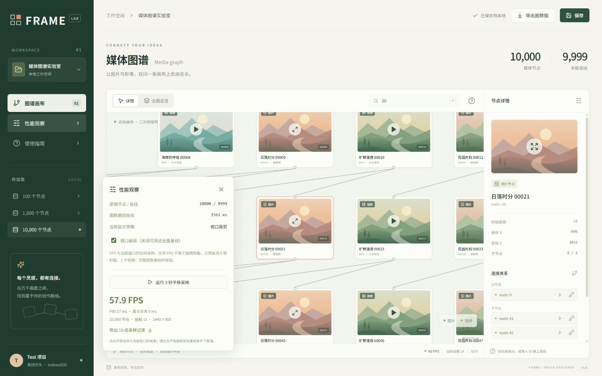

# 操作演示

1. 打开默认工作区，在数据集选择 10,000 节点。标题右侧显示 10,000 / 9,999。
2. 拖动节点、缩放、平移；输入 `9999` 定位到深层节点，再点击根节点按钮返回。

3. 点击封面预览图片或视频。右侧“替换为本地素材”可导入图片和视频，等保存完成后刷新确认恢复。

4. 选择 node-3，断开父节点连线；选择 node-7000，输入子节点 ID `3` 建立新连接。等保存完成，刷新后再次定位 node-3 检查父节点与位置。
5. 打开总览，点击聚合子树进入详情，或者继续按 ID 搜索。

6. 打开性能观察，在前台运行平移采样，导出记录。复测时注明素材数量、可见卡片数、视口与构建模式。

演示截图来自独立验收工作区。全部原始采样及异常值见 `frame-browser-samples.json`，边界见项目根目录 `VALIDATION.md`。
